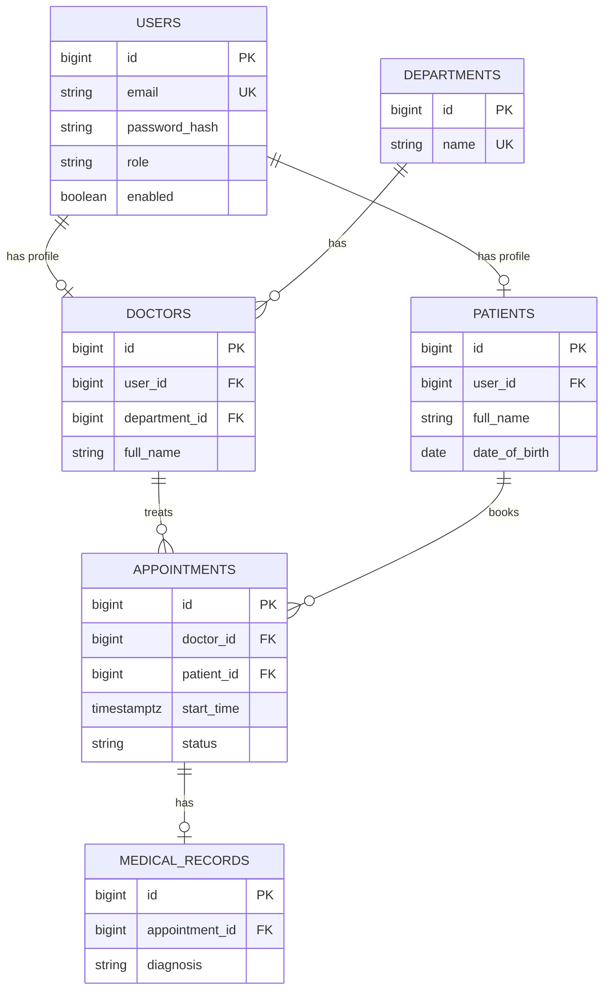

# Hospital Management System API

A role-based REST API for managing a hospital's departments, doctors, patients, appointments and medical records. Built with Java 21, Spring Boot 4, Spring Security (JWT) and PostgreSQL.

---

## Features

- **JWT authentication** with BCrypt password hashing and stateless sessions
- **Three roles** (Admin, Doctor, Patient) enforced with method-level security, plus **ownership checks** so users reach only their own data
- **Appointment booking** on 30-minute slots, with a free-slot lookup per doctor and day
- **Double-booking protection** enforced by the database, not only by application code
- **Medical records** that only the treating doctor can write, and only the treating doctor and the patient can read
- **Paginated search** for doctors and patients
- **Consistent JSON errors** for validation failures, conflicts, missing data and access problems
- **Versioned database schema** with Flyway; Hibernate only validates it
- **Health endpoint** through Spring Boot Actuator

---

## Roles and permissions

| Action | Admin | Doctor | Patient |
| --- | :---: | :---: | :---: |
| Register an account | n/a | n/a | ✅ (self-registration) |
| Manage departments | ✅ | ❌ | ❌ |
| Create and update doctors | ✅ | ❌ | ❌ |
| View departments and doctors | ✅ | ✅ | ✅ |
| List all patients | ✅ | ❌ | ❌ |
| View or update a patient | ✅ | ❌ | ✅ (own record only) |
| Book an appointment | ❌ | ❌ | ✅ (for themselves) |
| View an appointment | ✅ | ✅ (own patients) | ✅ (own) |
| Cancel an appointment | ✅ | ✅ (own) | ✅ (own) |
| Complete an appointment | ❌ | ✅ (own, after it starts) | ❌ |
| Write a medical record | ❌ | ✅ (own, after completion) | ❌ |
| Read a medical record | ❌ | ✅ (own) | ✅ (own) |

Admins manage the system but cannot read clinical records (least privilege).

## Business rules

- Appointments start on the hour or half hour, between 09:00 and 16:30 clinic time (the clinic is open 09:00 to 17:00)
- Bookings must be in the future and at most 90 days ahead
- A doctor cannot have two active appointments in the same slot, and neither can a patient
- A cancelled slot can be booked again
- Only a booked appointment can be cancelled, and only before it starts
- An appointment can be completed only after it starts, and only by its doctor
- A medical record can be added once per appointment, after completion

---

## Tech stack

| Layer | Technology |
| --- | --- |
| Language and framework | Java 21, Spring Boot 4.1 |
| Web and validation | Spring Web MVC, Jakarta Bean Validation |
| Security | Spring Security 7, OAuth2 Resource Server (JWT, HS256), BCrypt |
| Persistence | Spring Data JPA, Hibernate 7, PostgreSQL |
| Migrations | Flyway |
| Operations | Spring Boot Actuator (health endpoint) |
| Build | Maven |

---

## Architecture

```
Client ──► Security filter chain (verify JWT, read role)
              │
              ▼
          Controller      HTTP only: validation, status codes, role rules (@PreAuthorize)
              │
              ▼
          Service         Business rules, ownership checks, transactions
              │
              ▼
          Repository      Spring Data JPA
              │
              ▼
          PostgreSQL      Constraints and partial unique indexes as the final safety net
```

### Entity relationships



### Design decisions

- **Login data is separate from profiles.** One `users` table holds credentials and role; doctors and patients are linked profiles, so authentication has a single place to look.
- **Flyway owns the schema.** Hibernate runs with `ddl-auto: validate`, so the app refuses to start if entities and tables disagree.
- **Double booking is stopped by the database.** Partial unique indexes on `(doctor_id, start_time)` and `(patient_id, start_time)` apply to non-cancelled rows. The service checks first for a friendly message, and a violation from two simultaneous requests becomes a `409 Conflict`.
- **Timestamps are stored in UTC** (`timestamptz`), and clinic hours are checked in the clinic's time zone (`app.clinic.zone`, default `Asia/Kolkata`).
- **Entities are never returned directly.** DTO records keep password hashes and internal fields out of responses.
- **Login errors are generic**, and a BCrypt comparison runs even for unknown emails, so neither the message nor the timing reveals whether an account exists.
- **Ownership is checked in the service layer or a small helper bean**, because it needs the loaded record; role checks stay on the controller methods.

---

## API overview

Send the token from `POST /api/auth/login` as `Authorization: Bearer <token>`.

| Method | Endpoint | Access |
| --- | --- | --- |
| POST | `/api/auth/login` | Public |
| POST | `/api/auth/register` | Public (creates a patient) |
| GET | `/api/auth/me` | Any logged-in user |
| GET | `/api/departments`, `/api/departments/{id}` | Any logged-in user |
| POST, PUT, DELETE | `/api/departments`, `/api/departments/{id}` | Admin |
| GET | `/api/doctors` (filters: `name`, `departmentId`, `page`, `size`), `/api/doctors/{id}` | Any logged-in user |
| POST, PUT | `/api/doctors`, `/api/doctors/{id}` | Admin |
| GET | `/api/patients` | Admin |
| GET, PUT | `/api/patients/{id}` | Admin or the patient themselves |
| POST | `/api/appointments` | Patient |
| GET | `/api/appointments/availability?doctorId=&date=` | Any logged-in user |
| GET | `/api/appointments/mine` | Patient, Doctor |
| GET | `/api/appointments/{id}` | Admin, the patient, the treating doctor |
| PATCH | `/api/appointments/{id}/cancel` | Admin, the patient, the treating doctor |
| PATCH | `/api/appointments/{id}/complete` | The treating doctor |
| POST | `/api/appointments/{id}/record` | The treating doctor |
| GET | `/api/appointments/{id}/record` | The patient, the treating doctor |
| GET | `/actuator/health` | Public |

Errors share one JSON shape:

```json
{
  "timestamp": "2026-11-02T04:30:00Z",
  "status": 409,
  "error": "Conflict",
  "message": "The doctor is already booked at this time.",
  "details": {}
}
```

Example booking request:

```json
{ "doctorId": 1, "startTime": "2026-12-01T10:00:00+05:30", "reason": "Chest pain" }
```

---

## Getting started

### Prerequisites

- JDK 21
- PostgreSQL 16 or newer
- Maven (the included wrapper is enough)

### 1. Create the database

Connect as the PostgreSQL superuser and run:

```sql
CREATE USER hospital_user WITH PASSWORD 'choose-a-password';
CREATE DATABASE hospital OWNER hospital_user;
```

Run the application as `hospital_user`, never as the superuser, so that Flyway creates tables owned by that user.

### 2. Configure environment variables

| Variable | Required | Description |
| --- | :---: | --- |
| `JWT_SECRET` | ✅ | Signing key, at least 32 characters. The app refuses to start without it. |
| `DB_PASSWORD` | ✅ | Password of the database user |
| `DB_URL` | | Default `jdbc:postgresql://localhost:5432/hospital` |
| `DB_USERNAME` | | Default `hospital_user` |
| `ADMIN_EMAIL` | ✅ (first run) | Email of the first admin account |
| `ADMIN_PASSWORD` | ✅ (first run) | Password of the first admin, at least 8 characters |

Generate a signing key with:

```bash
node -e "console.log(require('crypto').randomBytes(48).toString('base64'))"
```

The first admin is created at startup only if no admin exists yet. Never commit these values.

### 3. Run

PowerShell:

```powershell
$env:JWT_SECRET = "<generated key>"
$env:DB_PASSWORD = "<your database password>"
$env:ADMIN_EMAIL = "admin@hospital.local"
$env:ADMIN_PASSWORD = "<a strong password>"
.\mvnw.cmd spring-boot:run
```

macOS and Linux:

```bash
export JWT_SECRET="<generated key>" DB_PASSWORD="<your database password>" \
       ADMIN_EMAIL="admin@hospital.local" ADMIN_PASSWORD="<a strong password>"
./mvnw spring-boot:run
```

Check that it is up: `http://localhost:8080/actuator/health` should return `{"status":"UP"}`.

To build a jar, use `.\mvnw.cmd -DskipTests package`. The generated context test needs a running database and the variables above, so skip it for plain builds.

---

## Testing

There is no automated test suite yet. The behaviour is verified with a scripted end-to-end check that calls the running API and prints PASS or FAIL for each rule:

```powershell
.\scripts\smoke-test.ps1
```

It covers login, role checks, ownership checks, double booking, slot validation, cancelling and rebooking, completion and medical-record privacy (about 60 checks). It prompts for your admin credentials, and the medical-record section asks you to age one appointment with a single SQL statement, because the API refuses to create appointments in the past. Use `-SkipRecords` to skip that section.

---

## Project structure

```
src/main/java/com/darshan/hospital/
├── config/        Security, JWT, password encoder, admin seeder, error handler for 401 and 403
├── controller/    REST controllers
├── dto/           Request and response records
├── entity/        JPA entities and enums
├── exception/     Custom exceptions and the global handler
├── repository/    Spring Data repositories
├── security/      Ownership checks and current-user helper
└── service/       Business rules and transactions
src/main/resources/
├── application.yml
└── db/migration/  V1 departments, V2 users/doctors/patients, V3 appointments/records
scripts/
└── smoke-test.ps1
```

---

## Known limitations and future work

- No automated unit or integration tests yet (planned: Mockito tests for the booking rules, a Testcontainers test for the unique indexes, and MockMvc tests for security)
- Not deployed yet; it runs locally against PostgreSQL (planned: Docker image and a hosted database)
- Access tokens last 60 minutes, with no refresh tokens and no server-side logout
- No rate limiting on the login endpoint
- Clinic hours and the 30-minute slot length are the same for every doctor, with no per-doctor schedules
- Doctor and patient accounts cannot be deactivated through the API yet
- No interactive API documentation (Swagger) yet

---

## Author

**Darshan**: [GitHub](https://github.com/RockyDarshan)